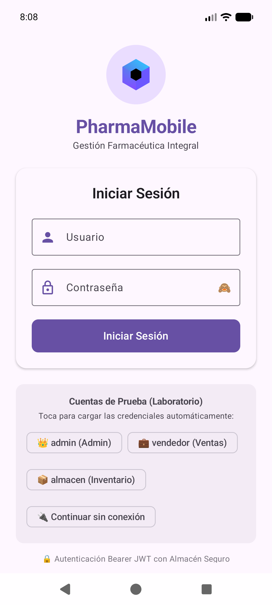
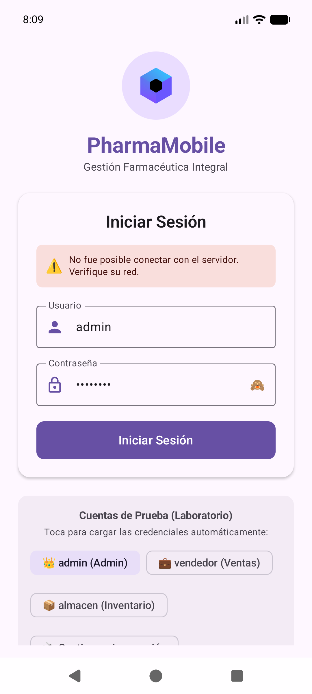
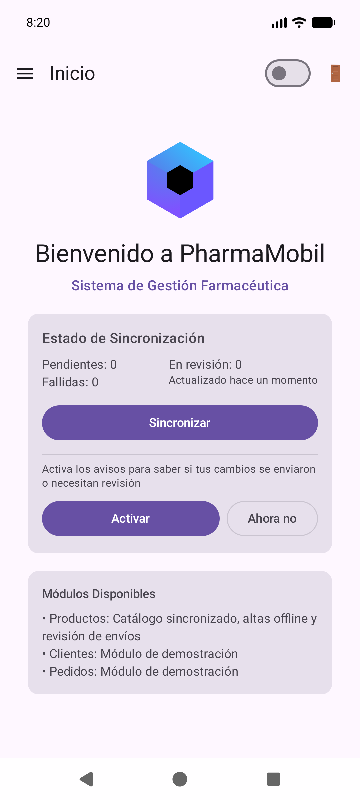
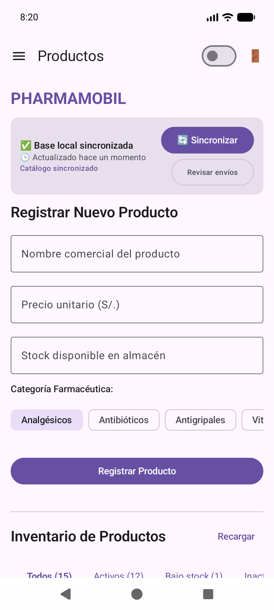

# Sesión 14 · Evidencias de los entregables

> Documento editable. Los campos `[[ ]]` los completas tú. Lo demás son datos reales,
> obtenidos con los comandos indicados el 11/11/2026.

| Dato | Valor |
|---|---|
| Estudiante / Equipo | [[Nombre y apellido]] · Equipo [[N]] |
| Rama | `feature/builds-14` |
| Proyecto | PharmaMobil (KMP) sobre PharmaSoft |

## Resumen

| # | Entregable | Estado | Evidencia |
|---|---|---|---|
| 1 | Ficha de integración cerrada | Hecha; completar `[[ ]]` | Sección 1 |
| 2 | `keystore.properties` en el README y 3 líneas en `.gitignore` | Cumplido | Sección 2 |
| 3 | Paquete firmado (`.aab`) e instalable de revisión (`.apk`) | Cumplido | Sección 3 |
| 4 | Verificación de la firma con titular y huella | Cumplido; adjuntar captura | Sección 4 |
| 5 | Archivo de iOS o evidencia con la limitación declarada | Limitación declarada | Sección 5 |
| 6 | Matriz con 2 dispositivos reales y defectos | Pendiente de completar | Sección 6 |

---

## 1. Ficha de integración cerrada

Archivo: [`01-ficha-integracion-y-alcance.md`](01-ficha-integracion-y-alcance.md)

| Decisión | Cantidad | Detalle |
|---|---|---|
| Cerrado | 10 | R1–R8 de la sesión 13, más R9 (notificaciones) y R10 (HTTP en release) corregidos en la auditoría |
| Se cierra hoy | 5 | URL del backend, reglas de R8, `versionName`, nombre de la app, README |
| Se declara como limitación | 4 | Clientes y Pedidos en memoria; sin build iOS; solo 2 dispositivos en clase; solo Android en dispositivo real |
| Descartado (trabajo futuro) | 5 | Ver sección 3 de la ficha |

Pendiente tuyo: completar tu nombre, equipo, fecha de congelación y la columna "Estado" con `[[ ]]`.

## 2. `keystore.properties` documentado y `.gitignore`

**README:** secciones "Firma sin exponer contraseñas" y "URL del backend en teléfonos reales" en [`README.md`](../../README.md).
Documenta qué contiene `keystore.properties` **sin ninguna contraseña**. La plantilla pública es [`keystore.properties.example`](../../keystore.properties.example).

**Las tres líneas en `.gitignore`:**

```
keystore.properties
*.jks
*.keystore
```

**Comprobación** (`git check-ignore -v`):

```
.gitignore:31:keystore.properties   keystore.properties
.gitignore:32:*.jks                 a.jks
.gitignore:33:*.keystore            b.keystore
```

**Ningún secreto está versionado:** `git ls-files | grep -iE 'keystore.properties$|\.jks$|\.keystore$'` devuelve 0 archivos.

**El proyecto compila sin el archivo de propiedades** (criterio 4 de la lista de cotejo): `assembleDebug` y
`assembleRelease` terminaron en `BUILD SUCCESSFUL` sin `keystore.properties`; el release salió sin firmar.

## 3. Paquete firmado e instalable de revisión

Ubicación: `C:\Users\USER\Downloads\entregables\`

| Archivo | Uso | SHA-256 |
|---|---|---|
| `EquipoN_ProyectoFinal_Android.aab` | Formato de tienda, no se instala | `b8883353942ebfdb1e6e923679a917d505410f474bd11513b9721f38e425cf93` |
| `EquipoN_ProyectoFinal_Android.apk` | Instalable de revisión | `335d89838be391401c14f610fb3e109bb11bf78a6fddf8937757eb09d706e2ea` |

| Dato de versión | Valor |
|---|---|
| `applicationId` | `pe.edu.upeu.pharmamobile2` |
| `versionCode` | `1` |
| `versionName` | `1.0.0` |
| Etiqueta de Git | `v1.0-final` (se pone al final, ver "Pendiente") |

Nomenclatura pedida: `Equipo<N>_ProyectoFinal_Android.aab`. Cambia `EquipoN` por tu número: [[N]].

Compilación:

```bash
./gradlew :androidApp:bundleRelease     # .aab
./gradlew :androidApp:assembleRelease   # .apk
```

## 4. Verificación de la firma (titular y huella)

**APK:** `apksigner verify --print-certs EquipoN_ProyectoFinal_Android.apk`

```
Signer #1 certificate DN: CN=Eduard Chambilla, OU=Facultad de Ingenieria y Arquitectura, O=Universidad Peruana Union, C=PE
Signer #1 certificate SHA-256 digest: eaa2c823700945b779072fe2b3198ed9711086dca8cab8215aab69f0ef12c1da
```

**AAB:** `jarsigner -verify` → `jar verified.` y `keytool -printcert -jarfile EquipoN_ProyectoFinal_Android.aab`:

```
Owner: CN=Eduard Chambilla, OU=Facultad de Ingenieria y Arquitectura, O=Universidad Peruana Union, C=PE
Valid from: Wed Nov 11 15:19:19 PET 2026 until: Sun Mar 29 15:19:19 PET 2054
SHA256: EA:A2:C8:23:70:09:45:B7:79:07:2F:E2:B3:19:8E:D9:71:10:86:DC:A8:CA:B8:21:5A:AB:69:F0:EF:12:C1:DA
```

| Comprobación | Resultado |
|---|---|
| Titular | Eduard Chambilla (no es la clave de depuración) |
| Huella del APK = huella del AAB = huella del almacén | Coinciden (`EA:A2:C8:…:C1:DA`) |
| Instalable generado desde el `.aab` con `bundletool` | Mismo certificado |

Salida completa: [`04-verificacion-firma.txt`](04-verificacion-firma.txt).

**Captura de pantalla (obligatoria):** [[Pega aquí la captura del comando `apksigner verify --print-certs`, con las líneas de titular y huella visibles]]

## 5. iOS

No se generó archivo de iOS: no hay macOS con Xcode ni dispositivo iOS.
Limitación declarada en [`06-ios-limitacion.md`](06-ios-limitacion.md) y en la sección de limitaciones de la ficha.
El proyecto `iosApp/` y los targets `iosArm64` / `iosSimulatorArm64` del módulo `shared` existen.

## 6. Matriz de pruebas en dispositivos reales

Plantilla: [`07-matriz-de-pruebas.md`](07-matriz-de-pruebas.md).

| Estado | Detalle |
|---|---|
| Dispositivo 1 | [[Marca, modelo y versión de Android]] — recorrido: [[completo / parcial]] |
| Dispositivo 2 | [[Marca, modelo y versión de Android]] — recorrido: [[completo / parcial]] |
| Defectos registrados | D-01 (corregido) y [[otros]] |

### Prueba previa en emulador (no cuenta como dispositivo real)

Release **firmado y minificado** en Pixel_7 (API 34) contra PharmaSoft real (Docker).

| Captura | Qué muestra |
|---|---|
|  | Login del release minificado tras corregir D-01 |
|  | Error de red controlado, sin cierre |
|  | Inicio tras iniciar sesión con el backend real |
|  | Catálogo sincronizado: "Todos (15)" |

### Defecto D-01 (corregido)

El release minificado se cerraba al abrir (`StackOverflowError` en Koin). R8 fusionaba `AuthRepository` y `GuardiaCuenta`
en `AuthRepositorioRest` y la resolución entraba en recursión. Corregido con un único registro `binds`; los 114 tests pasan.
Detalle en [`05-minificacion-r8.md`](05-minificacion-r8.md).

### Capturas de tus teléfonos

[[Adjunta aquí capturas de cada dispositivo real: instalación, login, catálogo y modo avión]]

---

## Commits de la sesión (uno por paso)

| Commit | Paso |
|---|---|
| `17f8d3f` docs(s14): cerrar ficha de integracion y congelar el alcance | 1 |
| `467495f` docs(s14): almacen de claves del equipo y su huella | 2 |
| `cad5c20` build(android): configurar firma de release sin exponer contrasenas | 3 |
| `a4790e6` build(s14): generar AAB y APK firmados y verificar la firma | 4 |
| `94b92cb` fix(build): activar R8 en release y corregir cierre al abrir por fusion de interfaces | 5 |
| `742c7d0` build(android): URL del backend configurable y red de release restringida al host del servicio | 3 / 5 (soporte) |
| `58c170d` docs(s14): declarar la limitacion de iOS y preparar la matriz de pruebas | 6 y 7 |

## Pendiente (tuyo)

1. Completar los `[[ ]]` de este documento y de la ficha.
2. Adjuntar la captura de la verificación de la firma (sección 4).
3. Recorrer el flujo de 8 pasos en 2 teléfonos y rellenar la matriz (sección 6).
4. Renombrar `EquipoN` con tu número, si aún no lo hiciste.
5. Hacer un último commit con tus datos, fusionar en `develop`, compilar de nuevo si cambió código y recién entonces etiquetar `v1.0-final`.
